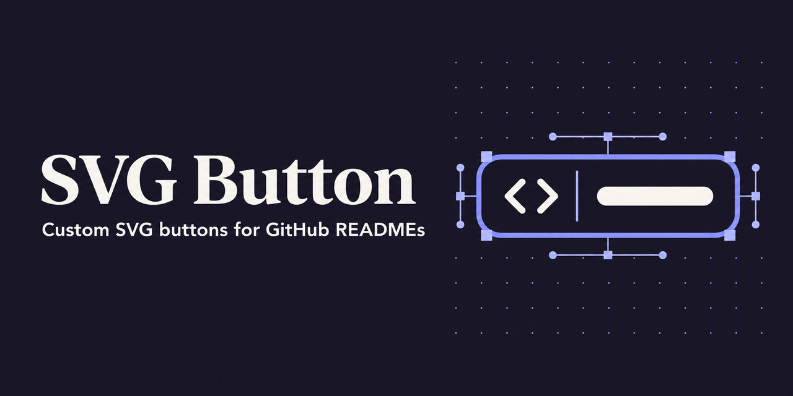

# SVG Button

Create custom SVG buttons for GitHub READMEs, documentation, and status pages. Give readers a clear way to open your docs, try a demo, or deploy a project.

[](https://svgbutton.com/)

## Why we built this

Traditional badge services are great for showing language versions, quality scores, and build status. Their preset styles can make it hard to turn a badge into a button that fits your page. We wanted to set the font size, adjust the horizontal and vertical padding, and choose or upload an icon. So we built SVG Button. :)

## Create and share a button

1. Open the [online editor](https://svgbutton.com/).
2. Set your label and adjust the font size, padding, colors, border, and corner radius. The preview updates as you edit.
3. Open the **Simple Icons** selector to search for a logo, or choose **Text** to put a second label on the left. To use your own icon, select **Import SVG** and upload a file, paste the SVG markup, or enter an HTTPS URL that allows cross-origin requests.
4. Under **Appearance**, choose **Split** to give the icon and text separate backgrounds without a divider line.
5. To set the SVG dimensions in pixels, check **Fixed Size** under **Button** and enter a width and height.
6. Add a **Destination URL** to make the Markdown button clickable.

### Embed in Markdown

Select **Markdown** in the preview, click the copy icon, and paste the snippet into your README or Markdown page.

```markdown
[](https://svgbutton.com/)
```

Select **Image** to preview the button and copy its hosted URL, or **SVG** to copy the markup. To keep the image in your repository, click **Download SVG**, save it as `docs/button.svg`, and use a relative image path.

```markdown
[](https://svgbutton.com/)
```

## API and self-hosting

You can also generate buttons directly from a URL. Find the supported parameters, SVG import limits, and self-hosting instructions in the [technical reference](docs/technical-reference.md).

To report a bug or propose a change, see the [contribution guide](CONTRIBUTING.md).

## License

SVG Button is licensed under the [MIT License](LICENSE).
